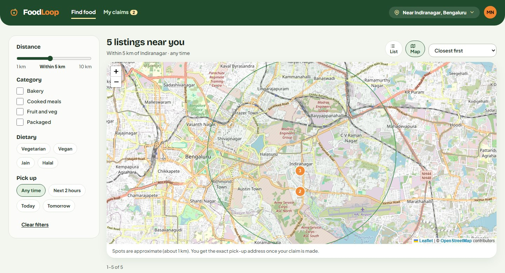
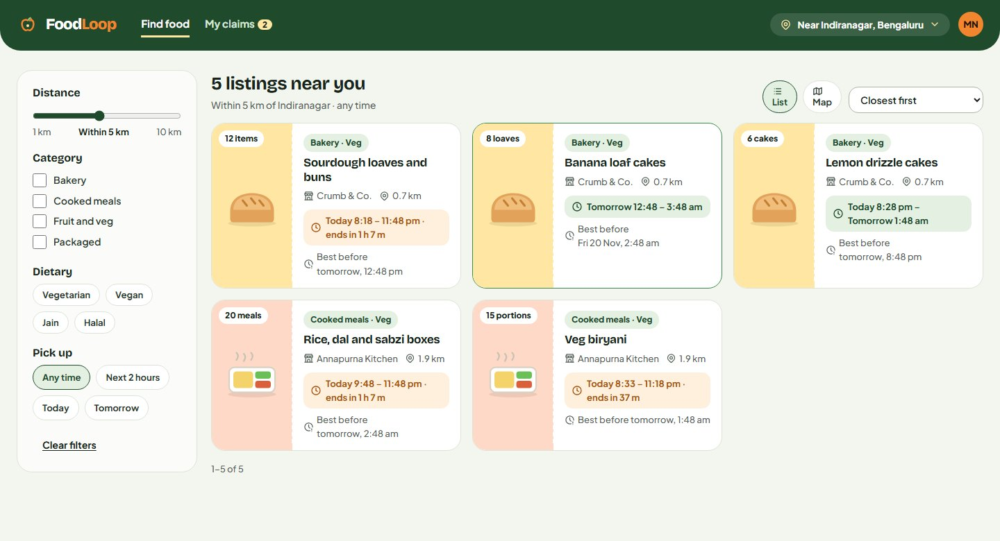
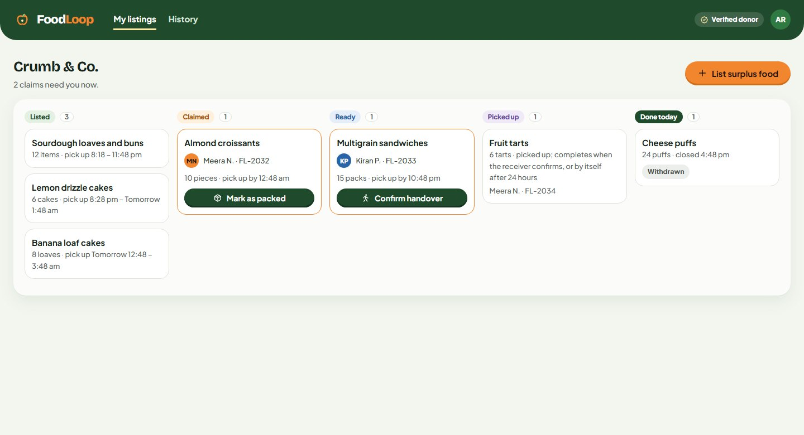

# FoodLoop

[](https://github.com/Pavithiran21/FoodLoop/actions/workflows/ci.yml)

**Live demo: [food-loop-orcin.vercel.app/demo](https://food-loop-orcin.vercel.app/demo)** (log in as a Donor, a Receiver or an Admin in one click). It runs on free hosting, so the first load after a quiet spell can take a minute or two.

A surplus-food marketplace. Restaurants, bakeries and shops list good food they would otherwise throw away. People and charities nearby find it by distance and claim it, and the two sides move the claim from "claimed" to "collected" before the pick-up window closes. Admins verify donors and handle reports.

**Java 21 · Spring Boot 4 · MySQL 8.4 · Flyway · React 19 · TanStack Query · Leaflet + OpenStreetMap · Tailwind CSS 4 · Playwright**



**What's hard here**

- **Two receivers, one listing, exactly one winner.** Claiming is a single conditional `UPDATE … WHERE status = 'LISTED'`, and only "1 row changed" inserts the claim. A UNIQUE index on a generated column stops two active claims at the database level as well. Ten receivers claiming at once get one 201 and nine 409s ([ListingRepository.java](backend/src/main/java/com/foodloop/listing/ListingRepository.java)).
- **A state machine for every move.** `ClaimMove` lists who may make each move and from which state. The wrong person gets 403, the wrong state 422, and each move locks the claim and then its listing, always in that order, so moves can't deadlock ([ClaimMove.java](backend/src/main/java/com/foodloop/claim/ClaimMove.java)).
- **A map that respects privacy.** Find food also shows results on an OpenStreetMap map. The API gives each listing a spot rounded to about 1 km, so the map shows the neighbourhood and never the donor's door. Listings at the same spot share one marker with a count ([FoodMap.jsx](frontend/src/features/find/FoodMap.jsx)).

| Find food (list) | Donor's board |
|---|---|
|  |  |

## Signature feature: a claim lifecycle that is safe under concurrency

**Two receivers, one listing, exactly one winner.** Claiming is a single conditional UPDATE: `… set status = CLAIMED where id = ? and status = LISTED and pickup_until > now` (`ListingRepository.claimIfAvailable`). Only the request that gets "1 row changed" inserts the claim. Everyone else gets **409**. A second guard sits in the schema: a generated column `active_listing_id` with a **UNIQUE index**, so the database itself refuses two active claims on one listing.

**A state machine for every later move.** `ClaimMove` (`backend/src/main/java/com/foodloop/claim/ClaimMove.java`) lists who may make each move and from which states:

```
CLAIMED --mark packed (donor)--> READY --confirm handover (donor)--> PICKED_UP --"I got it" (receiver)--> COMPLETED
CLAIMED or READY --cancel (donor or receiver)--> CANCELLED   (the listing goes back to LISTED if its window is still open)
CLAIMED or READY --pick-up window ends (job)--> EXPIRED      PICKED_UP --24 hours (job)--> COMPLETED
```

The wrong person gets **403**; the wrong state gets **422**. Each move locks the claim row (`SELECT … FOR UPDATE`), checks the move, then updates the claim and its listing in one transaction. The lock order is always claim then listing, the same order the jobs use, so moves can't deadlock each other. A rare deadlock with an account suspension running at the same moment is retried (`DeadlockRetry`).

**Expiry on time, exactly once.** The expiry job closes listings and claims whose pick-up window has ended with `UPDATE … WHERE id = ? AND status = …`. Only the run that changes the row sends the email, so overlapping runs and the job endpoint can't double-close or double-email. A second job completes picked-up claims after 24 hours.

## Features

- Sign up as Donor or Receiver (Admin is never selectable), log in, profile, password reset by email, delete my account (others' claims are kept but anonymised)
- Donors must be verified by an Admin before they can list; a verification email links straight to the listing form
- Listings: item, quantity, category, dietary info, pick-up window, expiry, optional photo (JPG or PNG up to 5 MB, stored as `LONGBLOB` in MySQL with the real type checked), edit or withdraw
- Find food by distance (haversine on stored latitude and longitude), category and time. Addresses are searched through OpenStreetMap Nominatim within its usage policy: a real User-Agent, at most 1 request a second, and day-long caching.
- **List or Map** (`?view=map`): the results on an OpenStreetMap map (Leaflet, loaded only when the map is opened). Each listing is at its approximate spot (2 decimals, about 1 km). Listings at the same spot share one marker with their count, and its popup links to each one. The exact pick-up address still comes only with a claim.
- Claim tracker for both sides; receivers can report a listing and donors can report a receiver; a food-safety disclaimer and the expiry on every listing
- Emails: new claim, claim confirmation, ready for pick-up, picked up and completed, expired, suspended or reinstated, donor verified or not verified, password reset
- Paginated lists and one JSON error format across the API

## Roles

| Role | Can | Cannot |
|------|-----|--------|
| Donor | List, edit and withdraw food once verified; mark packed; confirm handover; cancel a claim; report a receiver | Claim food (403) |
| Receiver | Find and claim food, confirm receipt, cancel a claim, report a listing | List food (403) |
| Admin | Verify or refuse donors, review reports, suspend and reinstate accounts | Suspend an Admin (403); Admins are created only by the seed command |

The Courier role was a stretch goal and was not built.

## Tech stack

| Layer | Choice |
|-------|--------|
| Backend | Java 21, Spring Boot 4.1.2 (Web MVC, Security, Data JPA, Validation, Mail, Thymeleaf), Flyway, MySQL 8.4, JJWT, Bucket4j + Caffeine |
| Frontend | React 19, Vite 8, React Router 8, TanStack Query 5, React Hook Form + Zod, Tailwind CSS 4, Tabler icons |
| Maps data | OpenStreetMap Nominatim (address search only, no map tiles) |
| Email | Any SMTP server: Ethereal for development, Brevo for real mail |

## Project structure

```
backend/src/main/java/com/foodloop/
  claim/          ClaimService (claim + moves), ClaimMove (the state machine)
  listing/        listings, photos, browse and distance search
  job/            ExpiryService, AutoCompleteService, ScheduledJobs, job runs
  donor/ admin/ report/   verification, reports, suspensions
  place/          Nominatim address search (rate-spaced and cached)
  auth/ user/ mail/ demo/ common/ (DeadlockRetry, Haversine, errors) config/ (FrontendConfig: STATIC_DIR)
  seed/           seed-dev / seed-demo / seed-admin / seed-test profiles, SampleData (Bengaluru)
backend/src/main/resources/  application.yml, db/migration/V1__init.sql, templates/mail/
frontend/src/     api/ auth/ features/ (find/FoodMap.jsx: the map) components/ layout/ ...
e2e/              Playwright: tests/api and tests/ui, mocks/nominatim-stub.js, make-env.js, prepare.js
.github/workflows/  CI: build, lint, the Playwright suite against MySQL 8.4, and the Docker image
Dockerfile        one image: Spring Boot also serves the built frontend (one origin)
```

## Run locally

**You need** Java 21 (Temurin), MySQL 8.4 and Node 26. Create the database once:

```powershell
mysql -u root -p -e "CREATE DATABASE foodloop"
```

Create `backend/.env`. It is read as a properties file, so write values **without quotes**.

| Variable | What it is |
|----------|------------|
| `DB_HOST`, `DB_PORT`, `DB_NAME`, `DB_USER`, `DB_PASSWORD` | MySQL connection (`127.0.0.1`, `3306`, `foodloop`, `root`, …) |
| `APP_ENV` | `development` or `production` |
| `PORT` | API port (4000) |
| `FRONTEND_URL` | `http://localhost:5173`, used in email links |
| `JWT_SECRET` | Signs access tokens (at least 32 characters) |
| `JOB_TRIGGER_SECRET` | Secret for `POST /api/internal/jobs/expiry` and `/auto-complete` |
| `RATE_LIMITS_ENABLED` | `true` |
| `LOG_LEVEL` | Root log level |
| `EXPIRY_CRON`, `AUTO_COMPLETE_CRON` | Job schedules |
| `TIME_OVERRIDE_ENABLED` | `true` lets jobs and requests run "as of" another moment; development only |
| `NOMINATIM_BASE_URL`, `NOMINATIM_USER_AGENT`, `NOMINATIM_COUNTRY_CODES` | Address search (Nominatim requires a real User-Agent) |
| `DEMO_MODE` | `true` enables the `/demo` page |
| `DEMO_PASSWORD` | Password given to the seeded sample accounts |
| `SMTP_HOST`, `SMTP_PORT`, `SMTP_USER`, `SMTP_PASS`, `SMTP_FROM` | Outgoing mail |
| `DEMO_SMTP_HOST`, `DEMO_SMTP_PORT`, `DEMO_SMTP_USER`, `DEMO_SMTP_PASS` | Inbox for mail to `@demo.foodloop.test` addresses, so demo mail never goes to a real server |
| `STATIC_DIR` | Optional. A built `frontend/dist`; Spring then serves the app too (the Docker image sets it) |

Then:

```powershell
cd backend
.\mvnw.cmd -q -DskipTests package
# Seeds run once and exit. Flyway creates the tables on the first start.
java -jar target\foodloop-backend.jar --spring.profiles.active=seed-dev --spring.main.web-application-type=none

# Your own first Admin (the password comes from an environment variable):
$env:ADMIN_PASSWORD='choose-one-with-a-number1'
java -jar target\foodloop-backend.jar --spring.profiles.active=seed-admin --spring.main.web-application-type=none --email=you@example.test --name="Your Name"
Remove-Item Env:ADMIN_PASSWORD

java -jar target\foodloop-backend.jar       # API on http://localhost:4000

cd ..\frontend
npm ci
npm run dev                                  # app on http://localhost:5173 (Vite proxies /api)
```

The dev seed **empties** the `foodloop` database and builds Bengaluru sample data: six donors (verified, waiting and refused), three receivers, two Admins, listings in every state and three reports. It refuses to run on any other database.

**Or with Docker** (MySQL included, no `.env` needed):

```powershell
docker compose up --build
docker compose exec app java -jar /app/app.jar --spring.profiles.active=seed-demo --spring.main.web-application-type=none
# then open http://localhost:4000/demo
```

## Demo accounts

With `DEMO_MODE=true`, **http://localhost:5173/demo** offers **Log in as Donor / Receiver / Admin**. The password is the one you set in `DEMO_PASSWORD`.

| Role | Email | What to try |
|------|-------|-------------|
| Donor | `donor@demo.foodloop.test` | List surplus food with a photo, mark a claim as packed, confirm a handover, withdraw a listing, open History. Blocked: Find food says "Only receivers can claim food". |
| Receiver | `receiver@demo.foodloop.test` | Filter Find food by Cooked meals, claim a listing, confirm "I got it", cancel a claim and see the food listed again. Blocked: listing food is refused (403). |
| Admin | `admin@demo.foodloop.test` | Verify a waiting donor, open and dismiss a report, suspend an account with a reason and reinstate it. Blocked: Admin accounts are "Seed script only". |

Demo accounts cannot change their email or password or delete themselves.

## Testing

**Playwright only**, in [`e2e/`](e2e): API tests with Playwright's `request` client and browser tests, against a real MySQL 8.4 (`foodloop_test`) and a real Ethereal inbox, with Nominatim replaced by a small stand-in ([`e2e/mocks/nominatim-stub.js`](e2e/mocks/nominatim-stub.js)). CI runs them on every push.

- **11 tests**: 8 API and 3 browser.
- **Concurrency:** ten receivers claiming one listing at the same moment get one 201 and nine 409s (`CLAIM_LOST`).
- **The state machine:** the full lifecycle claimed → ready → picked up → completed, each by the right person. The wrong person gets 403 and the wrong state 422 (`ILLEGAL_TRANSITION`). A cancelled claim lists the food again for someone else. Donors can't claim and receivers can't list (403), and a stranger's claim answers 404.
- **Jobs:** expiry closes an unclaimed listing and an open claim once the window ends, then runs twice more in parallel without closing anything twice.
- **The map:** cards carry `approxLat`/`approxLng` rounded to 2 decimals, never the exact spot or street. In the browser, Map shows one marker per spot, and its popup lists every listing there. Map tiles are stubbed, so a run never loads OpenStreetMap.
- **Roles and email:** the Donor board, the demo Admin's Verify donors page, and a password reset through the emailed link.

Requests pin "now" with `X-Test-Now` (refused in production). Every test claims its own Donors and Receivers from a seeded pool (400 and 2,000, an atomic lock file per person), so tests run in parallel.

```powershell
cd e2e
npm ci
npx playwright install chromium
npm test        # writes .env.test, builds the jar, creates and seeds foodloop_test, starts the stub, the API and the app
```

## Deploy

The frontend runs on [Vercel](https://vercel.com) and the API on [Render](https://render.com), and the browser still sees one origin: [`frontend/vercel.json`](frontend/vercel.json) forwards `/api/*` to the Render service, so the cookies (SameSite=Strict) work with no CORS or cross-site cookies.

- **Frontend (Vercel):** import the repository, set the Root Directory to `frontend` (framework Vite, build `npm run build`, output `dist`). `vercel.json` also sends every other path to `index.html` for React Router and sets the page's security headers. If the Render service is renamed, change its URL in `vercel.json`.
- **API (Render):** one free web service from `Dockerfile.api` (see [`render.yaml`](render.yaml)). Flyway migrates on every start. The full `Dockerfile` (API plus built frontend on one origin) is what `docker-compose.yml` and CI use.

- **Database:** a free hosted MySQL-compatible database such as [TiDB Cloud](https://tidbcloud.com) Starter, with a `foodloop_demo` database. It requires TLS, so set `SPRING_DATASOURCE_URL` with `sslMode=VERIFY_IDENTITY` (see `render.yaml`). The claim guard (the conditional `UPDATE` and the UNIQUE index on a generated column) works there, and so do the row locks, which are plain `SELECT … FOR UPDATE` statements (TiDB refuses the `FOR UPDATE OF <alias>` form that Hibernate's lock mode would send). A lost claim is explained with a locking read, so it reads the newest state on any database. The whole Playwright suite, including the ten-receivers-one-listing test, passes on TiDB and on MySQL 8.4.
- **Settings:** `APP_ENV=production`, `SERVER_FORWARD_HEADERS_STRATEGY=native` and `SERVER_TOMCAT_REMOTEIP_INTERNAL_PROXIES=.*` (so rate limits see the visitor's IP behind Vercel and Render's proxies), `DEMO_MODE=true`, `FRONTEND_URL` = the Vercel URL, a `NOMINATIM_USER_AGENT` that names the app, and SMTP plus `DEMO_SMTP_*`.
- **Demo data:** free Render has no Shell, so run the `seed-demo` profile once from your own machine, pointed at the same database.
- **Memory:** the image caps the JVM heap at half of the free plan's 512 MB, and the app stays near 350 MB under load.
- **Jobs:** free services sleep after 15 minutes without traffic, so an external cron (e.g. cron-job.org, every 5 minutes) calls `POST /api/internal/jobs/expiry` and `/auto-complete` with the `X-Job-Secret` header.
- **Email on free hosting:** Render's free plan blocks outbound SMTP, so the live demo sends no email (claim notices, donor decisions, password reset); everything else works. Paid hosting or an email provider with an HTTPS API would lift this.
- **Address search on free hosting:** the search goes to OpenStreetMap's Nominatim, which refuses the shared address that free Render uses, so the live demo reaches it through a small free Cloudflare Worker, [`docs/cloudflare-relay.js`](docs/cloudflare-relay.js). Set `NOMINATIM_BASE_URL` to `https://<your-worker>.workers.dev/<secret>/nominatim`; the Worker forwards only `/search`, only for GET and only when the secret matches, and caches each answer for a day (Nominatim's policy asks for caching and light use). On a host Nominatim accepts (your own machine, a paid instance), the default address works as it is. Without either, "Find address" (sign-up, profile, a receiver's "Another address") answers "Address search isn't available right now" and the rest of the app works.

## Demo videos

- `FoodLoop-full-workflow.webm`: a donor signs up and is verified, food is listed, two receivers claim one listing at the same moment and exactly one wins, the claim runs to completion, a report, the expiry job, and suspend and reinstate
- `FoodLoop-donor-demo.webm`, `FoodLoop-receiver-demo.webm`, `FoodLoop-admin-demo.webm`: one walkthrough per role

<!-- To embed: edit this README on GitHub and drag the .webm files from the workspace videos/ folder here. -->

## License

Copyright (c) 2026 R.Pavithiran. All rights reserved. The source is public so you can read it and see how it is built. Please ask before copying, reusing or redistributing it.
